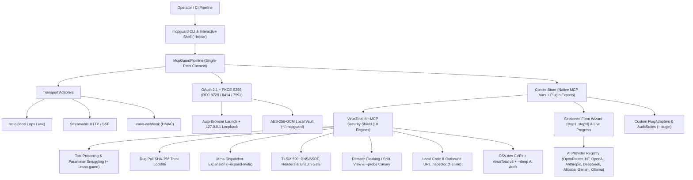

<div align="center">

```text
  ·                      ✦     ▄ ▀██    █▀                                  
           ▄▄▄▄▄▄     ▄▄      █▀ ▄█    ██  ▄ █ ▄▄█   ▄ ▀██ ▄ █▄ ▄██    ▄ ▀█▄
        ▄██████████▄ ▄▀▀         ██    █▀ ▀ ▄██▀   ▄▀  ▄█    ██▀ ██  ▄█   ██
      ▄████▀▀▀▀▀▀████▄▄          ██   ▄█    ██    ▄█  ▄██   ▄█   █▀ ▄██   █▀
     ▄███▀▄█▀▀▀▀█▄▀███▄ ▀▄       ▀▀  ▀▀▀ ▀  ▀     ▀▀▀▀ ▀▀ ▀ ▀▀   ▀ ▀ ▀▀  ▀  
     ███▀▄█▄████▄█▄▀███  █                                                  
   ▄▀▄▄▄ ▄▄▀████▀▄▄ ▄▄▄▀▀                       ▄                  ▄▄▄      
  █  ▀███ ▀▄█▀▀█▄▀ ████                ▄▄▄▄▄▄▄ ▀                ▄▀          
  ▀ ▄▄████▄▄▀▀▀▀▄▄███▀  ◐            █   ▄█      ▄▄▄     ▄▄▄   ▄█    ▄▄▄    
       ▀▀██████████▀▀               ▀▀   ██    █▀  ██  █▀  ██  █▀  ██  ▀    
          ▀▀▀▀▀▀▀▀                      ▄█    ██   █▀ ██   █▀ ██    ▀█▄     
  ☾                      ·            ▄▄█▄    ▀█▄▄▀   ▀█▄▄▀   ██▄▀▄▄▄▄▀     
```

# `⚡ @uranotools/mcpguard`

**`// INTERACTIVE MCP CLI  ·  INLINE AI FLAG STREAMING  ·  VIRUSTOTAL-STYLE MCP SECURITY SHIELD`**

<p>
  <a href="https://www.npmjs.com/package/@uranotools/mcpguard">
    
  </a>
  <a href="https://www.npmjs.com/package/@uranotools/mcpguard">
    
  </a>
  <a href="https://nodejs.org/">
    = 18" />
  </a>
  <a href="https://www.typescriptlang.org/">
    
  </a>
  <a href="./LICENSE">
    
  </a>
  <a href="https://github.com/uranotools/mcpguard/actions">
    
  </a>
</p>

<p>
  <code>Zero-Bloat Runtime</code> · <code>OAuth 2.1 + PKCE</code> · <code>10 Security Engines</code> · <code>AES-256-GCM Vault</code> · <code>@uranotools/urano-guard Bridge</code>
</p>

<p>
  <a href="#-quick-start">Quick Start</a> •
  <a href="#-architecture--closed-loop-pipeline">Architecture</a> •
  <a href="#-virustotal-for-mcp-security-shield">Security Shield</a> •
  <a href="#-interactive-shell---iniciar">Shell Mode</a> •
  <a href="#-ai-providers--inline-flag-streaming">AI Flags</a> •
  <a href="./DEV_README.md">Dev SDK</a> •
  <a href="./TESTING.md">Testing</a>
</p>

</div>

---

> **`[MISSION]`** Most MCP CLIs are dumb pipes for agents. **`mcpguard`** turns any **Model Context Protocol** server — local `stdio`, remote `Streamable HTTP/SSE` with OAuth 2.1, or HMAC Urano webhooks — into a **hardened, interactive terminal workbench** with real-time AI flag assistance and a multi-engine cybersecurity shield.

---

## `01 //` Architecture & Closed-Loop Pipeline

Every command (`install`, `scan`, `report`, `audit`, `invoke`) runs through a **single self-feeding pipeline** backed by `ContextStore` (`@uranotools/mcpguard/core`). One connection discovers the MCP once; security engines, custom `FlagAdapter` plugins, `AuditSuite` tests, and the interactive wizard all read from — and publish back into — the exact same live context.



---

## `02 //` Quick Start

```bash
# Install globally
npm install -g @uranotools/mcpguard

# Or run instantly with npx
npx @uranotools/mcpguard --iniciar
```

### Connect a Remote MCP (Auto OAuth 2.1 + Security Gate)

```bash
# Discovers RFC 9728 / RFC 8414 OAuth, launches browser, captures 127.0.0.1 callback,
# runs all security engines, and pins SHA-256 tool hashes in trust.lock.json
mcpguard install https://myurano.com/mcp --name myurano

# Connect a local stdio MCP
mcpguard install "npx -y @modelcontextprotocol/server-filesystem ./docs" --name fs

# Connect with static Bearer token or API key
mcpguard install https://mcp.example.com/v1 --auth bearer --token "$MCP_TOKEN"
```

---

## `03 //` Interactive Shell (`--iniciar`)

Launch the internal CLI workbench with the Urano Tools header, `Tab` autocompletion, persistent `↑ / ↓` command history (`~/.mcpguard/shell_history.txt`), and session-wide global flags:

```bash
mcpguard --iniciar --animate --accent phosphor
```

```text
mcpguard › set --security strict
  ✓ Global flag --security = strict

mcpguard [--security] › scan myurano --expand-meta --detail --verbose
mcpguard [--security] › myurano call_action -i
mcpguard [--security] › report myurano --format md --out audit.md
mcpguard [--security] › globals
mcpguard [--security] › exit
```

---

## `04 //` VirusTotal-for-MCP Security Shield

Audit any remote URL, local MCP directory, npm `stdio` command, or installed server with live per-engine progress and a `0–100` verdict (`CLEAN` · `WARN` · `SUSPICIOUS` · `MALICIOUS`):

```bash
# Full auditor dossier with grouped tools + live Meta-Dispatcher expansion
mcpguard scan myurano --detail --expand-meta --verbose

# Laser-focused engine subset
mcpguard scan myurano --only tls,meta,poison --expand-meta

# Zoom into one report section (tls | meta | tools | findings | arch | oauth)
mcpguard scan myurano --section tls

# Safe opt-in behavioral probe (error stack-trace disclosure + synthetic canary token)
mcpguard scan myurano --probe

# Deep semantic LLM audit + VirusTotal API v3 reputation
mcpguard scan myurano --deep --vt-key "$VT_API_KEY"

# Continuous live drift / Rug Pull watch mode (every 15s)
mcpguard scan myurano --only lock,tls --watch 15

# Export full Markdown + Mermaid architecture report
mcpguard report ./my-local-mcp --format md --out security-audit.md
```

### Real Audit Output Sample

```text
▸ Scanning myurano...
  [1/10] Rug Pull SHA-256 Trust Lockfile... OK (2ms)
  [2/10] Tool Poisoning & Prompt Injection... OK (143ms)
  [3/10] Blast Radius & Permissions... WARN (1ms)
  [4/10] Meta-Dispatcher & Dynamic Surface... OK (41ms)
  [5/10] Local Code & Outbound URL Inspector... SKIP (0ms)
  [6/10] TLS/X.509, DNS, Headers & Auth Gate... WARN (302ms)
  [7/10] Remote URL Posture, Cloaking & Leak Audit... OK (504ms)
  [8/10] Supply Chain, OSV.dev & Threat Feeds... OK (0ms)
  [9/10] VirusTotal API v3 Reputation... SKIP (0ms)
  [10/10] Deep Semantic AI Auditor... SKIP (1ms)

┌──────────────────────────────────────────────────────────────────────────┐
  MCPGuard Security Audit — https://myurano.com/mcp
  Verdict: WARN  |  Score: 80/100  |  2/7 engines flagged  |  994ms
└──────────────────────────────────────────────────────────────────────────┘
```

### Inspection Depth Matrix (100% Transparent)

| Layer | Capabilities | Local `stdio` MCP | Remote `https://` MCP |
|---|---|:---:|:---:|
| **L1 · Protocol & Crypto** | Tool Poisoning, Parameter Smuggling, Invisible Unicode/BiDi, Rug Pull SHA-256 Diff, Blast Radius, Meta-Dispatcher Detection | ✅ | ✅ |
| **L1.5 · Network & Probing** | Real TLS/X.509 Certs, DNS/SSRF Check, HTTP Security Headers, Broken-Auth (`401`) Check, Cloaking/Split-View Diff, `--probe` Canary, `--expand-meta` | ✅ | ✅ |
| **L2 · Static Code Audit** | Outbound URLs & Domains, `process.env` Reads, `child_process`/`fs`/`eval` with `file:line` evidence + OSV.dev CVEs | ✅ | Black-box (disclosed in report) |
| **L3 · Runtime Guard** | Pre-call Secret Leak Blocking/Masking (`sk-`, `ghp_`, `AKIA`, JWTs) + Post-call Indirect Prompt Injection Scanner | ✅ | ✅ |

---

## `05 //` AI Providers & Inline Flag Streaming

Configure any major LLM provider in one command (API keys are encrypted in `~/.mcpguard/credentials.json` via AES-256-GCM):

| Provider ID | Driver | Default Endpoint | Env Var | Default Model |
|---|---|---|---|---|
| `openrouter` | `openai-compat` | `https://openrouter.ai/api/v1` | `OPENROUTER_API_KEY` | `anthropic/claude-3.5-sonnet` |
| `huggingface` | `openai-compat` | `https://router.huggingface.co/v1` | `HF_TOKEN` | `Qwen/Qwen2.5-72B-Instruct` |
| `openai` | `openai-compat` | `https://api.openai.com/v1` | `OPENAI_API_KEY` | `gpt-4o-mini` |
| `anthropic` | `anthropic` | `https://api.anthropic.com/v1` | `ANTHROPIC_API_KEY` | `claude-3-5-haiku-latest` |
| `deepseek` | `openai-compat` | `https://api.deepseek.com/v1` | `DEEPSEEK_API_KEY` | `deepseek-chat` |
| `alibaba` | `openai-compat` | `https://dashscope-intl.aliyuncs.com/compatible-mode/v1` | `DASHSCOPE_API_KEY` | `qwen-plus` |
| `gemini` | `gemini` | `https://generativelanguage.googleapis.com/v1beta` | `GEMINI_API_KEY` | `gemini-2.5-flash` |
| `ollama` | `openai-compat` | `http://127.0.0.1:11434/v1` | *(none)* | `qwen2.5:7b` |

```bash
# Install & test an AI provider
mcpguard provider add openrouter --api-key "$OPENROUTER_API_KEY" --model deepseek/deepseek-chat --default
mcpguard provider test

# Interactive sectioned wizard (type "@ai <prompt>" inside ANY step to stream live)
mcpguard myurano call_action -i

# Stream AI into a single flag before execution
mcpguard crm register_form --name "Urano Coffee" --ai-field descripcion="Write a crisp product blurb"

# Full structured AI autofill with Human-in-the-Loop preview
mcpguard crm register_form --ai "Create an organic coffee SKU" --dry-run
```

---

## `06 //` Native Utilities & Open-Source Extensibility

```bash
mcpguard audit myurano --group owasp-mcp              # Run built-in or custom AuditSuites
mcpguard audit myurano --plugin ./my-flag.mjs         # Load custom FlagAdapters & SecurityEngines
mcpguard trust diff myurano                           # Inspect SHA-256 schema drift (Rug Pull check)
mcpguard trust approve myurano                        # Re-pin hashes after review
mcpguard inspect myurano call_action                  # Inspect schema & step1..stepN breakdown
mcpguard doctor                                       # Environment, vault & provider diagnostics
mcpguard export --target claude                       # Export config to Claude / Cursor / VS Code / Antigravity
```

### Documentation

- **[`DEV_README.md`](./DEV_README.md)** — Internal Core SDK (`@uranotools/mcpguard/core`), `ContextStore` native variables, building custom `FlagAdapter` plugins, `SecurityEngine` modules, and transport adapters.
- **[`TESTING.md`](./TESTING.md)** — Running the test suite (`npm test`), testing existing CLI flags, and authoring reusable `AuditSuite` test groups.

---

<div align="center">

**Built by [UranoTools Open Source](https://github.com/uranotools)** · MIT License

</div>
